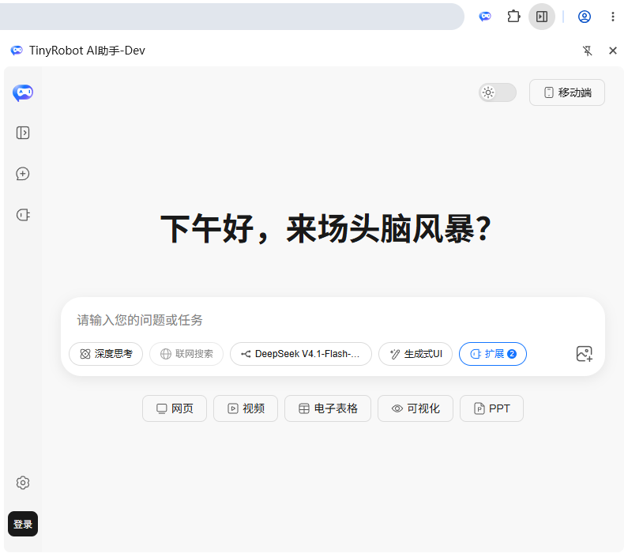
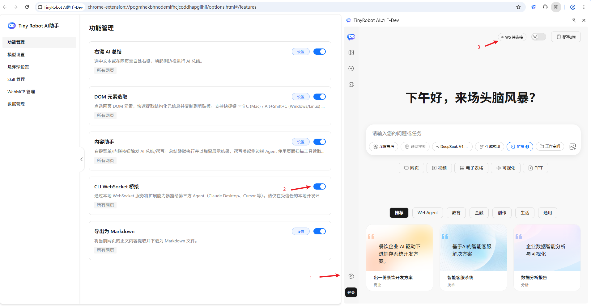
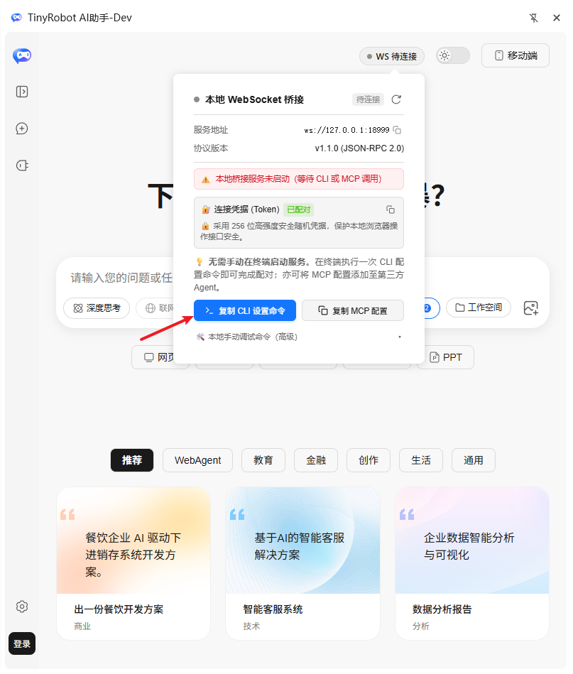
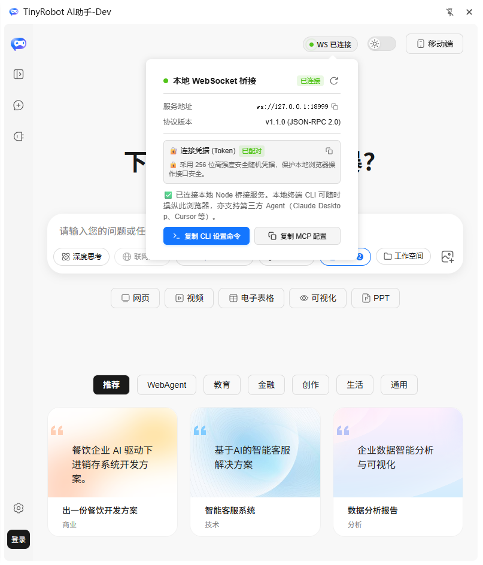

# 安装

## 前置要求

由于扩展需要动态注入脚本并接管部分无障碍功能，要求：

- **Chrome**：>= 120.0.0
- **Microsoft Edge**：>= 120.0.0
- **其他 Chromium 内核浏览器**：版本 >= 120.0.0（基于 Chromium 120+）

## 步骤一：下载并解压

1. 访问 [下载地址](https://docs.opentiny.design/download/extension-0.0.7.zip) 下载扩展压缩包到本地。
2. 将其解压到一个**固定的文件夹**（安装后请勿移动或删除该文件夹）。

## 步骤二：开启开发者模式

1. 打开浏览器的菜单：扩展程序-->扩展管理页面（或者在Chrome 地址栏输入 `chrome://extensions/`）。
2. 开启右上角的"开发者模式"（Developer mode）。

## 步骤三：加载扩展

1. 点击"加载已解压的扩展程序"（Load unpacked）按钮。
2. 在弹出窗口中选择刚才解压出来的文件夹。

## 步骤四：启动本地ci【可选】

打开插件的选项设置页面，在【功能管理】中，打开 【CLI WebSocket 桥接】插件的开关。

然后鼠标移动到插件的对话框顶部的 【WS 待连接】按钮之上，等提示窗出现后,点击【复制CLI设置命令】：

将命令粘贴到本地终端上，等待TinyRobot 插件与它握手成功：

之后，请注册与登录，

- [注册与登录](./usage/register-login.md)：账号、额度与使用统计。
