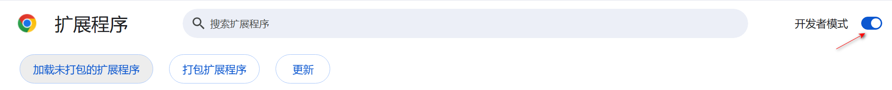
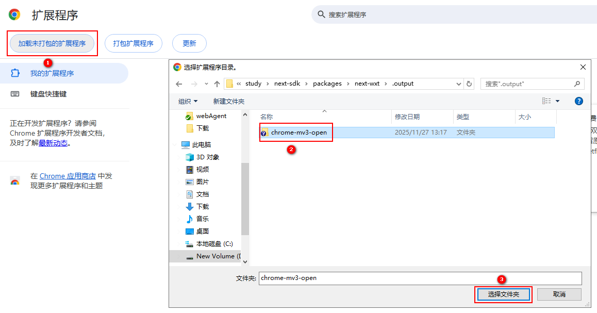

# 安装

## 前置要求 【重新核实】

由于扩展需要动态注入脚本并接管部分无障碍功能，要求：

- **Chrome**：>= 120.0.0
- **Microsoft Edge**：>= 120.0.0
- **其他 Chromium 内核浏览器**：版本 >= 120.0.0（基于 Chromium 120+）

### 步骤一：下载并解压

1. 访问 [下载地址](https://docs.opentiny.design/download/extension-0.0.7.zip) 下载扩展压缩包到本地。
2. 将其解压到一个**固定的文件夹**（安装后请勿移动或删除该文件夹）。

### 步骤二：开启开发者模式

1. 打开浏览器的扩展管理页面（Chrome 地址栏输入 `chrome://extensions/`）。
2. 开启右上角的"开发者模式"（Developer mode）。

### 步骤三：加载扩展

1. 点击"加载已解压的扩展程序"（Load unpacked）按钮。
2. 在弹出窗口中选择刚才解压出来的文件夹。

### 步骤四：启动本地ci

## 下一步

- [配置大模型](./model-config)：装完插件后第一件事，配置你要用的 AI 模型
- [MCP工具开发指南](./next-wxt)：学习如何把自己网站的功能暴露给 AI
- [Skills 技能开发指南](./skills)：学习如何给 AI 补充专业知识
- [工作原理](./architecture)：想深入了解原理时阅读
