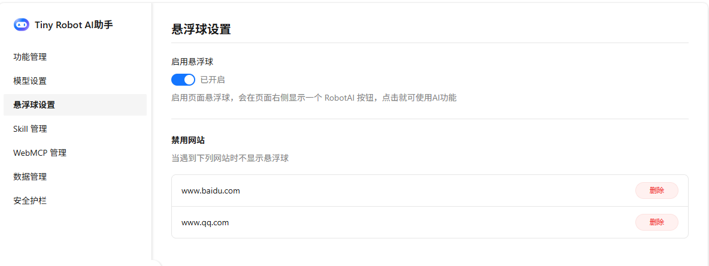

# 悬浮球设置

悬浮球设置位于配置页（独立标签页）左侧导航中，与网页悬浮球右键菜单的「隐藏悬浮球」操作配合使用：在页面上禁用悬浮球时，本页的对应状态会同步变化；反过来，也可以在本页恢复或调整悬浮球的显示范围。悬浮球本身的交互说明见 [界面说明 · 悬浮球](../usage/ui-overview.md)。

本页包含两个设置块：**启用悬浮球**开关与**禁用网站**列表。

## 启用悬浮球

控制悬浮球全局是否可用，旁边显示当前状态（已开启 / 未开启）

当你在网页悬浮球右键菜单中选择「隐藏悬浮球 → 永久禁用」时，这里的开关会同步变为未开启；在本页重新打开开关，即可恢复悬浮球在所有网页上的显示（命中禁用网站的域名除外）。

## 禁用网站

「禁用网站」按域名（hostname）禁用悬浮球：已禁用的域名在网页打开时不会自动显示悬浮球，说明文案为「当遇到下列网站时不显示悬浮球」。

::: tip
在页面上修改悬浮球设置后，已打开的配置页会自动刷新对应状态；反之在配置页修改后，已打开的网页也会实时联动，无需手动刷新。
:::

## 三种隐藏方式对照

悬浮球右键菜单提供 3 种隐藏方式，作用范围与恢复途径各不相同：

| 隐藏方式             | 作用范围         | 恢复方式                             |
| -------------------- | ---------------- | ------------------------------------ |
| 本次关闭直到下次访问 | 当前页面本次会话 | 刷新页面或下次访问自动恢复，无需设置 |
| 当前网站禁用         | 当前域名         | 在本页「禁用网站」中删除对应域名     |
| 永久禁用             | 所有网页         | 在本页重新打开「启用悬浮球」开关     |

::: tip
「悬浮助手」属于内核插件，常驻且不能在「功能管理」中关闭；悬浮球是否显示仅由本页设置与悬浮球右键菜单控制。
:::

## 相关链接

- [界面说明](../usage/ui-overview.md)：悬浮球拖动、菜单与任务状态的图解。
