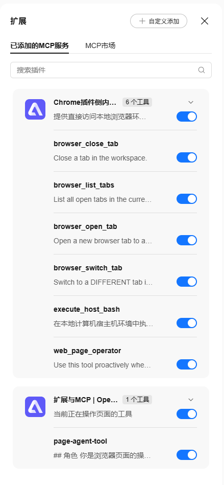
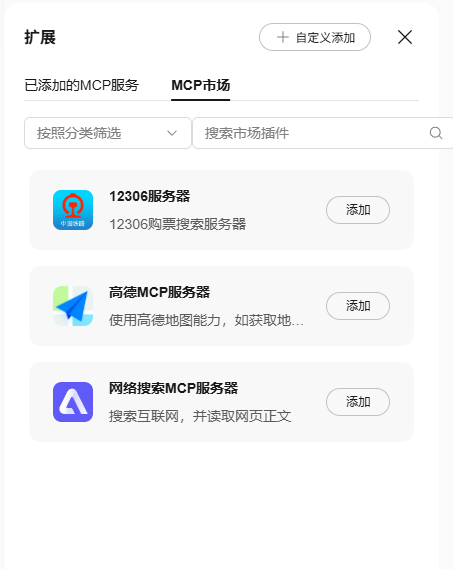
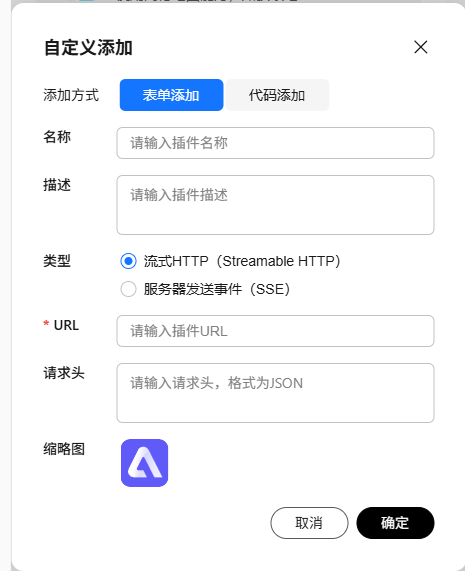

# 扩展与MCP

点击对话输入区的**扩展**按钮（带已启用工具数量徽标），会在右侧打开抽屉弹窗，用于控制当前对话可使用哪些工具函数——每一个工具都可以随时启用或禁用，修改后立即在当前会话生效。

抽屉顶部提供「已添加的MCP服务」与「MCP市场」两个页签，以及「自定义添加」入口；「已添加」页签支持按名称搜索插件。每个 MCP 服务以卡片展示（名称、工具数量、简介与整体开关），展开后可看到该服务注册的每一个工具及其独立开关。扩展中的工具主要来自下面 4 类 MCP Server。



## 操作 Chrome 的 MCP 工具

这是 TinyRobot AI助手 为 Chrome 浏览器统一增加的页面操作工具（`builtin-mcp-server`），通过它们可以实现通用的浏览器操作：

| 工具                 | 作用                                                                                                                                          |
| -------------------- | --------------------------------------------------------------------------------------------------------------------------------------------- |
| `browser_open_tab`   | 打开新标签页并跳转到指定 URL（必填 `url`），加入当前工作区，返回 `tabId` 与 `workspaceId`                                                     |
| `browser_list_tabs`  | 列出当前工作区中所有打开的标签页；仅在需要发现后台标签页或做多标签管理时调用                                                                  |
| `browser_switch_tab` | 切换到工作区中的另一个标签页；操作或总结当前页面时无需调用                                                                                    |
| `browser_close_tab`  | 关闭工作区中指定的标签页（高风险操作）                                                                                                        |
| `execute_host_bash`  | 在本地计算机宿主机环境中执行 Bash / Shell 命令；依赖本地 CLI 与 WebSocket 桥接，执行范围收敛在已授权工作空间或默认隔离沙箱内，仅主 Agent 可见 |
| `web_page_operator`  | 网页子 Agent：接收自然语言指令（`instruction`），默认在工作区目标标签页上自主完成多步操作，可选指定 `tabId` 与 `maxSteps`                     |

其中 `browser_*` 工具都用于操作浏览器标签页；`execute_host_bash` 用于本地计算机环境；`web_page_operator` 用于操作当前页面。

`web_page_operator` 本身不直接改动页面，而是作为子 Agent 在目标页面上循环调用页面原子工具完成任务，能力包括：获取页面状态（`browserState`）、查找元素索引（`searchTree`）、点击元素（`click`）、填写表单文本（`fill`）、下拉项选择（`select`）、悬停（`hover`）、滚动页面（`scroll`）与执行页面脚本（`executeJavascript`）。执行期间目标页面会出现操作遮罩与模拟光标，对话中则以步骤卡片展示每一步动作。

::: tip
`web_page_operator` 只能操作 `http(s)` 网页。若当前标签页是空白页或 `chrome://` 等浏览器内部页，它会返回错误提示先调用 `browser_open_tab` 打开网页；操作当前页面时也无需调用 `browser_list_tabs` / `browser_switch_tab`。
:::

## 页面 MCP 工具

这一类是**当前打开的网页上下文中已经注册的原生 WebMCP 工具函数**（`page-mcp-server`）。业务系统可以通过 `document.modelContext` 对象（`registerTool` / `registerPageAgentTool`）进行工具注册；扩展为每个页面注入了原生 WebMCP 的 polyfill，因此任何浏览器版本都可以使用 `document.modelContext` 对象。页面切换或页面工具注册变化时，抽屉中的页面工具列表会实时刷新。

`page-agent-tool` 是内置的 WebMCP 工具，默认注入到每一个页面。它可以读写当前页面、生成元素索引、点击元素、填写表单文本值、下拉项选择、执行页面脚本等，具体动作如下：

| 动作                | 作用                         |
| ------------------- | ---------------------------- |
| `browserState`      | 获取页面状态与可交互元素索引 |
| `searchTree`        | 按关键字查找页面元素         |
| `click` / `hover`   | 点击 / 悬停指定索引的元素    |
| `fill` / `select`   | 填写表单文本 / 选择下拉项    |
| `scroll`            | 滚动页面或指定元素           |
| `executeJavascript` | 在页面中执行脚本             |

不想改动网站源码时，还可以在「配置页 → WebMCP 管理」中编写自定义 WebMCP 脚本，按域名匹配注入目标页面并注册工具，见 [WebMCP管理](../setting/webmcp-config.md)。

## MCP 市场工具



「MCP市场」页签是 OpenTiny 团队提供的一组线上 MCP Server 服务（Streamable HTTP 端点），支持按分类筛选与名称搜索，点击「添加」即可把服务注册的工具加入当前对话：

| 服务              | 能力                                                              |
| ----------------- | ----------------------------------------------------------------- |
| 12306服务器       | 12306 购票搜索：余票查询、中转查询、经停站查询、车站搜索          |
| 高德MCP服务器     | 使用高德地图能力，如获取地理信息等，工具集与高德官方托管 MCP 一致 |
| 网络搜索MCP服务器 | 搜索互联网（`web_search`），并读取网页正文（`web_fetch`）         |

## 自定义 MCP 工具



任何标准的 MCP Server 都可以自行添加到扩展中，在对话中使用它注册的工具。现在有 2 种方式添加自定义工具：

1. **表单添加**：填写名称、描述、类型（流式 HTTP / 服务器发送事件 SSE）、URL、请求头（JSON 格式）与缩略图。
2. **代码添加**：直接粘贴 MCP Server 的 JSON 配置，例如：

```json
{
  "mcpServers": {
    "MyMcpServer": {
      "url": "https://xxxx",
      "type": "StreamableHTTP"
    }
  }
}
```

添加后的服务会出现在「已添加的MCP服务」页签中，与内置服务一样按卡片管理整体开关与单个工具开关。

## 下一步

- [界面说明](./ui-overview.md)：扩展按钮与抽屉入口的位置图解。
- [WebMCP管理](../setting/webmcp-config.md)：按域名编写页面级自定义 WebMCP 脚本。
- [模型设置](../setting/model-config.md)：切换对话使用的大模型。
