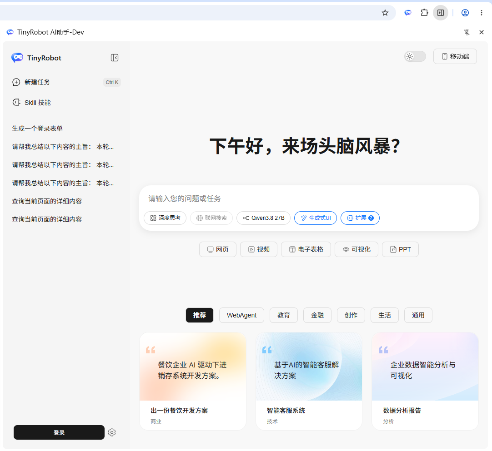
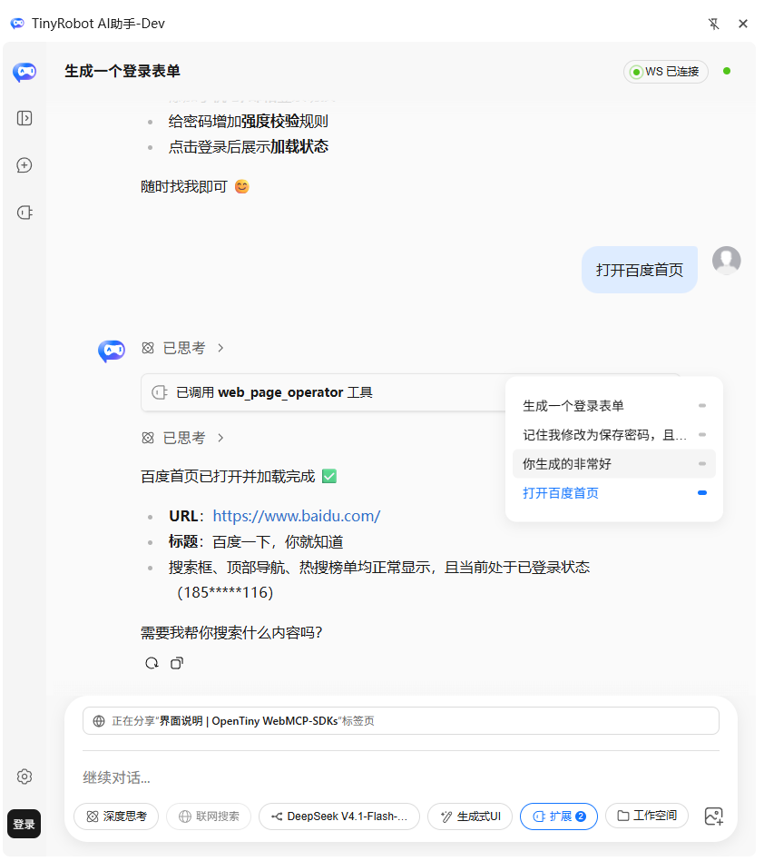
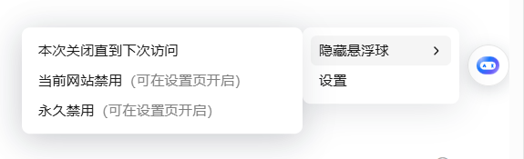
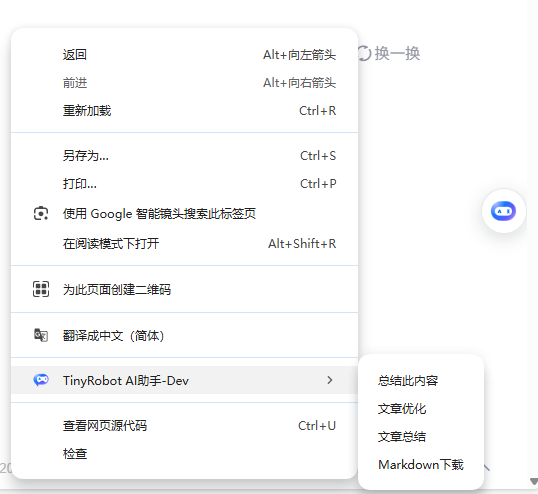

# 界面说明

**TinyRobot AI助手** 的界面由四个入口组成：**侧边栏**（AI 对话与任务执行的主界面）、**悬浮球**（网页内的快捷入口）、**右键菜单**（在页面右键中唤起 AI 能力）与**配置页**（独立标签页中的设置中心）。本页按入口逐一图解各界面元素的作用。

## 侧边栏：初始对话界面

点击浏览器工具栏上的 TinyRobot 图标即可展开侧边栏。未发起对话时，侧边栏呈现初始对话界面，下图为展开会话菜单后的界面：

### 会话栏（左侧）

| 元素         | 作用                                                                                       |
| ------------ | ------------------------------------------------------------------------------------------ |
| 折叠按钮     | 折叠 / 展开会话栏，为对话区腾出空间                                                        |
| 新建任务     | 创建一个新会话                                                                             |
| Skill 技能   | 打开当前插件拥有的技能列表；技能的增删改在配置页「Skill管理」中进行                        |
| 历史会话列表 | 按时间列出历史会话，点击即可切换回对应会话                                                 |
| 登录 / 头像  | 未登录时显示「登录」按钮并打开登录页；登录后显示头像（个人中心），可查看使用统计、退出登录 |
| 设置齿轮     | 在独立标签页中打开配置页                                                                   |

### 顶部工具

| 元素     | 作用                                                                |
| -------- | ------------------------------------------------------------------- |
| 主题切换 | 在深色主题与浅色主题之间切换                                        |
| 移动端   | 生成携带当前会话信息的 URL 二维码，用手机扫码即可在移动端预览该会话 |

### 对话输入区

| 元素               | 作用                                                                                         |
| ------------------ | -------------------------------------------------------------------------------------------- |
| 输入框             | 输入用户的问题或任务描述                                                                     |
| 深度思考           | 开启深度思考模式，是否生效依赖所选模型的能力                                                 |
| 联网搜索           | 开启联网搜索模式，是否生效依赖所选模型的能力                                                 |
| 模型选择器         | 切换当前会话使用的大模型                                                                     |
| 生成式UI           | 开启生成式 UI 模式，是否生效依赖所选模型的能力                                               |
| 扩展（带数量徽标） | 在右侧打开抽屉弹窗，控制当前对话可使用哪些工具函数；详见 [扩展与MCP](./extension-and-mcp.md) |
| 技能快捷按钮       | 「网页 / 视频 / 电子表格 / 可视化 / PPT」，一键切换任务类型                                  |
| 推荐提示词卡片     | 按「推荐 / WebAgent / 教育 / 金融 / 创作 / 生活 / 通用」分类的示例任务，点击即可填入输入框   |

::: tip
开启「CLI WebSocket 桥接」后，侧边栏还会出现 **WS 状态徽章**（`WS 待连接` / `WS 已连接`）与**本地工作空间**按钮，分别用于管理本地桥接连接、为当前会话绑定本地文件夹，见 [安装指南](../install.md)。
:::

## 侧边栏：对话界面

发起对话后，对话区会渲染思考链、工具调用与消息工具栏：

1. **思考链**：以「已思考」折叠块渲染模型的推理过程，点击可展开查看。
2. **工具调用**：以「已调用 `<工具名>` 工具」卡片渲染每一次工具调用，展开可查看工具的参数与返回值，并支持一键复制。
3. **消息工具栏**：AI 消息底部提供「重新生成」与「复制」按钮，可重复对话或复制对话结果。
4. **对话导航**：对话区右侧的圆点列表对应当前上下文的每一轮对话，点击可迅速跳转到相应位置。
5. **标签页分享横幅**：输入框上方的「正在分享 “xxx” 标签页」横幅，表示当前会话正在读取或操作该标签页。

## 悬浮球

启用浏览器插件后，默认会在用户页面产生一个悬浮球，用于快速操作一些内置插件功能：

1. **拖动吸附**：悬浮球可以拖动，松手时自动吸附在页面左 / 右两侧。
2. **左键菜单**：左键点击展开插件快捷菜单，点击菜单项即触发对应插件功能。默认为「AI 对话」，已开启的插件会追加条目，例如「Markdown 下载」「文章总结」「DOM 元素选取」。
3. **右键菜单**：右键点击出现「隐藏悬浮球」与「设置」两个菜单。
   - 隐藏悬浮球有 3 种方式：**本次关闭直到下次访问**（刷新页面后恢复）、**当前网站禁用**（仅当前域名不再出现）、**永久禁用**（所有网页都不出现），后两种可在设置页恢复。
   - 要恢复悬浮球显示，请在配置页「悬浮球设置」中打开，见 [悬浮球设置](../setting/floating-ui-config.md)。
   - 「设置」菜单直接打开插件的配置页。
4. **任务状态**：某些插件执行任务时，悬浮球会展开显示任务的当前状态（任务标题与旋转描边），点击停止按钮可以停止当前任务。

## 右键菜单

启用浏览器插件后，默认的一些内置插件会注册右键菜单到页面右键菜单的 `TinyRobot AI助手` 父菜单下（开发构建显示为 `TinyRobot AI助手-Dev`）：

| 菜单项       | 触发条件              | 作用                                     |
| ------------ | --------------------- | ---------------------------------------- |
| 总结此内容   | 选中文本后右键        | 对选中片段做 AI 总结，结果以页面弹窗展示 |
| 文章总结     | 选中或空白处右键      | 对整页文章做 AI 总结                     |
| 文章优化     | 选中 / 可编辑区域右键 | 唤起侧边栏，对内容进行帮写与优化         |
| Markdown下载 | 选中或空白处右键      | 提取正文并下载为 Markdown 文件           |

::: tip
右键菜单项由插件注册：「总结此内容 / 文章总结 / 文章优化」来自**内容助手**插件，「Markdown下载」来自**导出为 Markdown** 插件。若菜单未出现，请在配置页「功能管理」中确认对应插件已开启，见 [功能管理](../setting/plugin-config.md)。
:::

## 配置页

配置页在独立标签页中打开（侧边栏的设置齿轮、悬浮球的「设置」菜单均可进入），包含功能管理、模型设置、悬浮球设置、Skill管理、WebMCP管理、数据管理与安全护栏等设置项，详见配置指南各页。

## 下一步

- [注册与登录](./register-login.md)：账号、免费额度与使用统计。
- [扩展与MCP](./extension-and-mcp.md)：浏览器工具、页面工具与 MCP 市场。
- [功能管理](../setting/plugin-config.md)：按域名开启或关闭内置插件。
- [悬浮球设置](../setting/floating-ui-config.md)：悬浮球的显示与站点黑名单。
