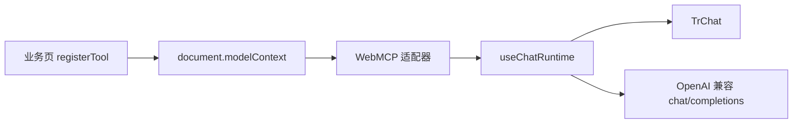

# Design：WebMCP Chat 模板

## 方案概述

新增 `packages/doc-ai/src/templates/WebMcpChat.vue`。组件内部：

1. `TrChat` 使用套件默认界面，模板不写插槽。
2. `mcp` 使用自定义适配器，把 `document.modelContext` 映射成 server `webmcp`。HTTP `mcpServers` 没有对应端点。
3. 技能用套件 `skillPlugin({ mode: 'auto' })`。模板只把 `SKILL.md` 解析成 `SkillDefinition`。

套件在一次用户消息开始时锁定本轮启用的工具 id。页面跳转后新注册的工具要等下一轮用户消息才会进入请求。系统提示里说明这一点。

## 涉及模块 / 文件

- `packages/doc-ai/src/templates/WebMcpChat.vue`（新增模板）
- `packages/doc-ai/src/App.vue`（改用模板）
- `packages/doc-ai/src/main.ts`（引入套件样式）
- `packages/doc-ai/package.json`（依赖）
- `packages/doc-ai/src/views/home/index.vue`（指引文案）

## 核心数据结构 / 类型定义

```typescript
interface UseChatRuntimeMcpAdapter {
  runtime: ChatMcpRuntime
  listTools: (
    serverIds: readonly string[],
    toolIds: Readonly<Record<string, readonly string[]>>
  ) => Promise<readonly {
    serverId: string
    id: string
    name: string // `${serverId}__${id}`，给模型看的函数名
    originalName: string
    description?: string
    inputSchema?: Record<string, unknown>
  }[]>
  callTool: (serverId: string, toolName: string, args: Record<string, unknown>) => Promise<unknown>
}
```

工具执行与 `getBuiltinMcpTools` 一致：`executeTool(descriptor, JSON.stringify(args))`。返回值优先取 MCP `content[].text`，再交给套件作为字符串。

系统提示和技能都通过套件的 `UseMessagePlugin` 进入请求，不自写请求循环。

## 依赖变更

- 新增 `@opentiny/tiny-robot@1.0.0-rc.2`、`@opentiny/tiny-robot-chat@1.0.0-rc.2`、`@opentiny/tiny-robot-kit@1.0.0-rc.2`、`dompurify`
- 移除 `@opentiny/next-remoter`
- 不改 catalog 里给 Remoter 用的 `0.3.1-alpha.6`

## API / 行为变更

| 符号或行为 | 变更类型 | 说明 |
|---|---|---|
| doc-ai 右侧对话框 | 修改 | Remoter 换为 Chat 套件模板 |
| `page-agent-chat-end` | 保持 | 仍在一轮请求结束后派发 |

## 数据流 / 时序



## 风险与兼容

- 套件按发送时的工具 id 锁定本轮。跳转后新工具不能在同一轮里被调用。
- 模型地址沿用 Remoter 试用网关 `https://agent.opentiny.design/api/v1/ai/chat/completions`，密钥 `sk-trial` 仅本地示例。
- `tiny-robot@1.0.0-rc.2` 的 peer 仍写成 `workspace:^`，安装时需要同时声明同版本 `tiny-robot-kit`。

## 备选方案

- 使用 HTTP `mcpServers.baseUrl`：WebMCP 没有 HTTP 端点，不能用默认适配器。
