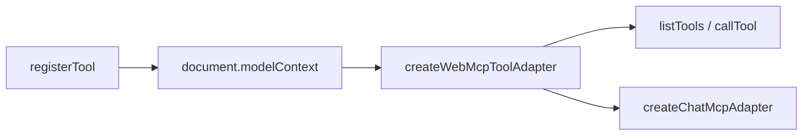

# Design：WebMCP 工具公共适配

## 方案概述

新增 `createWebMcpToolAdapter()`。它只认识 `document.modelContext` 的 `listTools` / `getTools` / `executeTool` / `toolchange`。

两种用法：

1. MCP 工具面：`listTools()`、`callTool(name, args)`、`subscribe(listener)`。
2. Chat 套件：`createChatMcpAdapter({ onScope, box })`。`box` 由调用方用自己的响应式实现（Vue 里是 `ref`）。SDK 不引用 Vue 或 `@opentiny/tiny-robot-chat`。

ai-sdk 继续走已有的 `getBuiltinMcpTools`，本适配器不替换它。

## 涉及模块 / 文件

- `packages/next-sdk/agent/webmcp-tool-adapter.ts`
- `packages/next-sdk/index.ts`
- `packages/next-sdk/test/agent/webmcp-tool-adapter.test.ts`
- `packages/doc-ai/src/templates/WebMcpChat.vue`

## 核心数据结构 / 类型定义

```typescript
interface WebMcpToolAdapter {
  readonly serverId: string
  listTools(): Promise<WebMcpListedTool[]>
  callTool(name: string, args?: Record<string, unknown>): Promise<string>
  subscribe(listener: () => void): () => void
  createChatMcpAdapter(bridge: WebMcpChatAdapterBridge): WebMcpChatMcpAdapter
}
```

默认 `serverId` 为 `webmcp`。执行与 `getBuiltinMcpTools` 相同：`executeTool(descriptor, JSON.stringify(args))`。返回值优先取 MCP `content[].text`。

## 依赖变更

无新依赖。

## API / 行为变更

| 符号或行为 | 变更类型 | 说明 |
|---|---|---|
| `createWebMcpToolAdapter` | 新增 | 公开导出 |
| doc-ai `WebMcpChat` | 修改 | 删除内联适配，改用上述导出 |

## 数据流 / 时序



## 风险与兼容

- Chat 界面要看到工具变化，调用方必须让 `box.value` 的读取可被追踪。
- 套件仍在发送时锁定本轮工具 id。跳转后新工具要等下一轮用户消息。

## 备选方案

- 让 next-sdk 直接依赖 tiny-robot-chat：会把 UI 套件耦合进浏览器 SDK。
