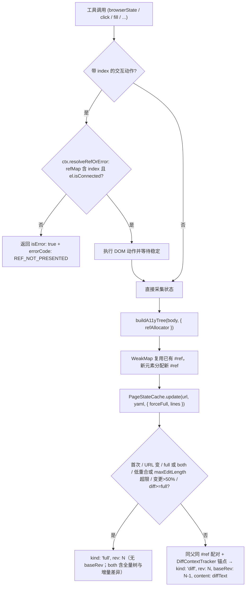

# Design：page-agent-tool 稳定元素编号与结构化增量 Diff 重构

## 方案概述

围绕「DOM 元素身份锚定」与「生成端保护性结构化 Diff」重构 `page-agent-tool` 的状态感知链路：

1. **元素身份层（`a11y/`）**：引入基于 `WeakMap<Element, number>` + 单调自增计数器的 `ElementRefAllocator`，替代每次重建归零的局部计数器；并在序列化后过滤 `refMap` 使其与 YAML 实际输出的 `#N` 集合严格一致。
2. **增量对比与版本层（`structured-yaml-diff.ts` / `page-state-cache.ts`）**：`structured-yaml-diff.ts` 实现基于稳定 `#ref` 的结构感知增量 Diff（同父同 `#ref` 及改名父节点下子节点就近配对、跨父移动按各自文档位置输出、无交互包装层与改名父节点全局抵消、`DiffContextTracker` 单调缩进上下文栈最小父级锚点）；`page-state-cache.ts` 维护会话级 `rev`/`baseRev` 版本号，并集中配置与执行三项熔断回退（前置大窗口 O(N) 低重合预判 / Myers `maxEditLength` 超限、变更行数占比 `> 50%`、Diff 文本长度 `>= 整页 YAML 长度`），命中任一项时自动回退整页树（`kind: 'full'`）。
3. **协议与生命周期层（`page-agent-tool.ts` / `context.ts` / `handlers/`）**：在状态 JSON 中输出 `kind`、`url`、`rev`、`baseRev`（公开类型 `BrowserStateSnapshot`）；统一各交互 handler 的失效引用错误为 `isError: true` + `errorCode: 'REF_NOT_PRESENTED'`；引入 `sessionGeneration` 守卫（`endTurn()` 与 `resetSession()` 均递增代次，令进行中的异步操作过期续体返回 `SESSION_RESET_ERROR_CODE`）；`PAGE_AGENT_CHAT_END_EVENT` 调用 `endTurn()` 清空 Diff 基线并拦截旧续体，`RegisteredPageAgentToolHandle.resetSession()` 用于新建/清空会话时完整归零，并通过 `window.__pageAgentResetSession` 委托给当前生效注册实例（与遮罩一致，在 `abort()` 注销旧实例后更新指针）。

## 涉及模块 / 文件

| 路径 | 职责 |
| --- | --- |
| `packages/next-sdk/page-tools/a11y/ref-allocator.ts` | 新增 `ElementRefAllocator` 与 `RefAllocator` 接口 |
| `packages/next-sdk/page-tools/a11y/types.ts` | `A11yTreeOptions` 增加可选 `refAllocator?: RefAllocator` |
| `packages/next-sdk/page-tools/a11y/vnode.ts` | `buildVNode` 通过 `RefAllocator` 分配稳定 `#ref`；编辑宿主（`contenteditable`）跳过单子合并保留自身 `textbox` ref；收集实际输出的 `#ref` |
| `packages/next-sdk/page-tools/a11y/build.ts` | 支持外部传入 `refAllocator`（默认新建临时实例保持纯函数兼容）；对齐 `refMap` 与输出 `lines` |
| `packages/next-sdk/page-tools/structured-yaml-diff.ts` | 纯函数结构化 YAML Diff 算法（首尾剥离与快速熔断 + Myers 整型键对比 + 全局无交互包装层/改名父节点配对抵消 + `DiffContextTracker` 单调缩进上下文栈锚点） |
| `packages/next-sdk/page-tools/page-state-cache.ts` | 页面状态版本缓存与三项熔断协议封装（维护 `rev`/`baseRev`、`fullReason` 及判别联合 `DiffResult`） |
| `packages/next-sdk/page-tools/context.ts` | 定义 `REF_NOT_PRESENTED_ERROR_CODE`、`SESSION_RESET_ERROR_CODE`、`PageAgentToolErrorCode`、`REF_ACTION_LABELS`、`BrowserStateResponseMode`、`BrowserStateSnapshot`、`ActionContext.resolveRefOrError` 与统一错误构造 |
| `packages/next-sdk/page-tools/page-agent-tool.ts` | 串联会话级 `ElementRefAllocator`、`PageStateCache`、`kind/rev/baseRev` 组装、`createInvocationContext` 代次守卫与 `resetSession` 句柄（经 `window.__pageAgentResetSession` 委托给当前生效实例，重置时同步 `unhighlight()`） |
| `packages/next-sdk/page-tools/page-agent-tool-event.ts` | 接收 `{ getRefMap, endTurn }`；`PAGE_AGENT_CHAT_END_EVENT` 触发 `endTurn()`；透传 `errorCode` |
| `packages/next-sdk/page-tools/handlers/{click,fill,select,hover,scroll}.ts` | 统一通过 `ctx.resolveRefOrError` 校验 `el && el.isConnected` 并返回 `REF_NOT_PRESENTED` |
| `packages/next-sdk/page-tools/handlers/searchTree.ts` | 共用 `refAllocator` 刷新 `currentRefMap`，不覆盖 Diff 基线以保持 `rev` 链连续 |
| `packages/next-sdk/page-tools/page-agent-prompt.md` | 更新 `#N` 稳定绑定、过期不复用、`kind/rev/baseRev` 与 Diff 格式说明 |
| `packages/next-sdk/index.ts` | 导出 `ElementRefAllocator`、`RefAllocator`、`REF_NOT_PRESENTED_ERROR_CODE`、`SESSION_RESET_ERROR_CODE`、`PageAgentToolErrorCode`、`BrowserStateSnapshot`、`SnapshotKind` |
| `docs/webmcp-sdk/page-agent-tool.md` / `packages/next-sdk/skills/page-agent/SKILL.md` | 同步用户文档与编码 Skill |

## 核心数据结构 / 类型定义

```typescript
/** DOM 元素稳定编号分配器接口 */
export interface RefAllocator {
  /** 为元素返回稳定编号：已分配则复用，未分配则单调递增分配新编号 */
  allocate(el: Element): number
  /** 重置映射表与计数器（新建或清空会话、宿主调用 resetSession() 时调用） */
  reset(): void
}

export type SnapshotKind = 'full' | 'diff'

export interface PageSnapshot {
  url: string
  lines: string[]
  rev: number
}

export interface StateCacheUpdateOptions {
  /** 强制返回全量快照（如显式传入 responseMode: 'full'） */
  forceFull?: boolean
  /** 调用方已拆好的纯内容行数组（如 buildA11yTree 返回的 lines），传入时跳过剥离围栏与重复拆行 */
  lines?: string[]
}

interface DiffResultBase {
  /** 当前快照版本号（从 1 单调递增，reset 后归 0） */
  rev: number
  /** 上一次快照的 URL */
  prevUrl: string
  /** 新增行数 */
  addedLines: number
  /** 删除行数 */
  removedLines: number
}

export interface FullDiffResult extends DiffResultBase {
  kind: 'full'
  /** 触发全量输出的原因（调试与测试断言用） */
  fullReason: 'initial' | 'url_changed' | 'forced' | 'diff_too_large'
  /** 全量输出时恒为空串 */
  diffText: ''
}

export interface IncrementalDiffResult extends DiffResultBase {
  kind: 'diff'
  /** 本 diff 所基于的基准快照版本号 */
  baseRev: number
  /** 结构化 +/- 差异文本（无变化时为 '# (no changes)'） */
  diffText: string
}

export type DiffResult = FullDiffResult | IncrementalDiffResult

export const REF_NOT_PRESENTED_ERROR_CODE = 'REF_NOT_PRESENTED' as const
export const SESSION_RESET_ERROR_CODE = 'SESSION_RESET' as const

export type PageAgentToolErrorCode =
  | typeof REF_NOT_PRESENTED_ERROR_CODE
  | typeof SESSION_RESET_ERROR_CODE

export type PageAgentToolErrorResult = PageAgentToolContentResult & {
  isError: true
  error: string
  errorCode?: PageAgentToolErrorCode
}

export type PageAgentToolHandle = {
  showMask: (options?: ShowMaskOptions) => Promise<void>
  hideMask: () => Promise<void>
  resetSession?: () => void
}

export type RegisteredPageAgentToolHandle = PageAgentToolHandle & {
  resetSession: () => void
}
```

## Diff 算法细节

1. **提取内容行与预计算父链**：剥离 `buildA11yTree` 外层 ```` ```yaml ```` 与 ```` ``` ```` 围栏，得到 `prevLines` 与 `currLines`；单次 O(N) 预计算每行的 `trimmed`、`indent`、`parentIndex`、`ref` 与直接父节点 `directParent`（带 `#ref` 用 `#N`，否则用父行 `trimmed`）。
2. **首尾公共行剥离与 O(N) 快速熔断**：先剥离首尾 `line` 与 `directParent` 完全相同的公共区间；当两侧中间区间行数之和 `>= 200` 时，先用 O(N) `trimmed` 多重集交集计算变更下界，若下界已超过 50% 直接跳过 Myers 返回 `diff_too_large`，避免整页重绘阻塞主线程。
3. **Myers 语义行对比 + 全局变更全集聚合**：将中间区间的 `(directParent, trimmed)` 映射为整型 ID 后执行 `diffArrays(prevIds, currIds, { maxEditLength })`（熔断参数由 `PageStateCache` 集中配置并注入，`maxEditLength = Math.max(250, Math.min(totalLines, 800))`，超限时直接返回 `undefined` 触发 `diff_too_large` 回退整页树），聚合成变更 Hunk、未变更行精确索引映射与全局 `allRemoved` / `allAdded`。
   - **已知边界**：由于 Myers 比较键含 `directParent`，无 `#ref` 容器改名或外加包装层时其每个直接子节点在抵消前计 2 次编辑；当该容器的直接子节点数超过约 `maxEditLength / 2`（800 行以上页面约 400 个直接子节点）时，会提前触发 `maxEditLength` 熔断回退整页树以保障主线程响应速度。
4. **全局包装层识别与父节点改名配对 LCS 抵消（`cancelWrapperAndRenamedParentShifts`）**：
   - 仅构建一次全局父子索引；
   - **无交互包装层抵消**：仅对无 `#ref` 候选包装行 `W` 生效（带 `#ref` 的交互容器不作为纯包装层折叠）；校验 `W` 的外层父节点精确映射到对侧同一父节点下标，并利用同父级左右最近未变更兄弟的映射区间 `(otherLowerBound, otherUpperBound)` 收紧到父节点子树范围 `[expectedOtherParentIdx, subtreeEnd)` 后过滤对侧候选：① 若窗口内对侧变更行存在相同 `trimmed`（拆包上移的已有容器）则跳过（不误伤别处同名节点消失）；② 若窗口内存在未进入 `W` 子节点且本身有子节点或具名的同 `role` 对侧节点（如原位改名容器）则跳过并交由改名配对处理；通过全部守卫后在过滤后的候选集上对其直接子节点求 `trimmed` LCS 并抵消；
   - **按缩进由浅入深的未变化兄弟抵消与父节点改名配对**：
     - 先在同一未变更外层父节点（`prevToCurrUnchanged`）下，按已锚定未变更直接兄弟切分的连续兄弟区间对本层未抵消同行节点做整行 LCS 抵消（`cancelIdenticalSiblingsInLayer`）并登记进 `prevToCurrUnchanged` / `pairedPrevToCurr`，消除容器跨父移动时 Myers 优先匹配移动子树而把未变化目标父节点（及其未变化子节点）拆进两个 Hunk 产生的虚假 `+/-`，同时因区间锚定严格保留同父重排；
     - 再对本层剩余有直接子节点的父节点借助直接子节点整行倒排索引贪心一对一配对（避免 $O(P^2)$ 扫描）。带 `#ref` 父节点与无 `#ref` 父节点均要求外层父级兼容且存在共享直接子节点；带 `#ref` 仅允许同 `#ref` 配对（分值 3）；无 `#ref` 要求同 role（正则支持转义引号与多 token）并支持词干/首词匹配（分值 0..2，含行内拼装名称与无名称改 token 容器），当双方名称均非空且名称分为 0 时，若任一方在同一外层父级下存在同词干节点则拒绝配对，否则要求两者在本层候选中的相对位置相同。候选按共享直接子节点数、名称相似度分、行号距离降序优选；真正改名的配对父节点记入 `pairedRenamedParentByCurrIdx` 供就近成对输出，并在配对父节点下仅对整行完全相同的子节点序列求 LCS 抵消（兼顾同父重排容器自身保留 `- / +` 而内部未变子节点不刷屏）。
   - **同名无 `#ref` 父节点间跨父移动还原（`restoreSameNamedCrossParentMoves`）**：在上述抵消与父节点映射就位后，扫描 `prevToCurrUnchanged` 检查被同名无 `#ref` 父节点骗过 Myers 比较键 `(directParent, trimmed)` 而误判为未变更的移动根节点（旧父与新父均明确对应两侧存活的不同父节点，天然排除嵌套同名包装层及容器删除引起的前缀歧义）；将其从 `prevToCurrUnchanged` 撤回并按当前文档坐标序拆分为旧父下 `-` 与新父下 `+` 两个独立 Hunk 输出，同时保持其内部未变子节点不重复刷屏。
5. **文档序输出与单调缩进上下文栈（`DiffContextTracker`）锚点**：
   - 复用预计算的 `ComparableLine.ref`（兼容多词 ARIA role：`/^\s*-\s+[^["]+?\s+#(\d+)(?:\s|$)/`）。
   - 同逻辑父节点（`directParent` 相等或旧/新父节点已在改名配对中配对）下内容/缩进真正变化（`old.line !== add.line`）的同 `#ref` 唯一配对，以及已配对改名父节点本身，作为同步配对锚点就近成对输出 `- / +`（整行相同而留存的同父重排节点不绑定配对，保留在各自文档位置输出）；若同父改写伴随外层包装导致的缩进变化，连续同旧父、同新父的配对项合批并共享一组锚点，先统一在旧父级缩进下输出该批 `-` 行，再统一在新父级缩进下输出该批 `+` 行；跨父移动不绑定配对，让 `-` 留在旧父级文档位置、`+` 留在新父级文档位置自然输出。
   - 独立的 `DiffContextTracker` 维护单调缩进栈，按节点身份下标（`curr:${currIdx}` / `prev:${prevIdx}`）与 `fromRemoved` 标记匹配而非按文本匹配（正确区分同名无 `#ref` 容器间移动，且 `-` 删除行绝不满足 `curr` 侧祖先匹配）：补齐某行祖先时对比栈中严格更小缩进的前缀，从第一个分叉层起联动补齐至直接父级（外层重出绝不跳过内层）；旧侧祖先若已改名则映射为当前侧新行，已删除父节点与已作为纯新增 `+` 行输出的外层包装容器不以 `  ` 上下文前缀重复输出。
   - **已知边界（祖先回溯深度）**：单行最多向上回溯 `MAX_ANCESTOR_CONTEXT_DEPTH = 2` 层祖先；当超过两层的同名嵌套容器（如 `region "A"` 与 `region "B"` 下均有完全同名的 `group > list`）发生跨最外层 `region` 移动时，2 层锚点仅展示 `group > list` 而不含更外层 `region`。
6. **三项熔断保护回退整页树**：
   - 若抵消后无任何实质变更，返回 `NO_CHANGES_DIFF_TEXT`（`# (no changes)`）。
   - 结合前述三项熔断条件：① 前置大窗口 O(N) 低重合预判或 Myers `maxEditLength` 超限；② `changedRatio = Math.max(addedLines, removedLines) / Math.max(prevLines.length, currLines.length) > 0.5`；③ `diffText.length >= yaml.length`（防体积倒挂）——命中任一项即判定 `fullReason = 'diff_too_large'`，回退为 `kind: 'full'`（不返回 `baseRev`，外层直接使用完整 `yaml`）。

## 依赖变更

无新增第三方依赖（复用已有 `diff` 包中的 `diffArrays`）。

## API / 行为变更

| 符号或行为 | 变更类型 | 说明 |
| --- | --- | --- |
| `ElementRefAllocator` / `RefAllocator` | 新增 | 稳定 DOM 元素 `#ref` 分配器，支持 `allocate(el)` 与 `reset()` |
| `A11yTreeOptions.refAllocator` | 新增（可选） | 允许外部传入持久化分配器；省略时单次调用仍从 `#0` 开始 |
| `PageAgentToolHandle.resetSession` / `RegisteredPageAgentToolHandle` | 新增 | `PageAgentToolHandle.resetSession` 保持可选兼容外部 mock；`registerPageAgentTool` 返回 `RegisteredPageAgentToolHandle` 必含 `resetSession()`，并通过 `window.__pageAgentResetSession` 委托给当前生效注册实例 |
| `PAGE_AGENT_CHAT_END_EVENT` 监听行为 | 修改 | 除 `hideMask()` 外调用 `endTurn()` 递增 `sessionGeneration`（令进行中的异步续体返回 `SESSION_RESET`）并清空 Diff 基线（`rev` 持续递增、`#ref` 不跨轮复用） |
| `BrowserStateSnapshot` / `SnapshotKind` | 新增 | 导出与 `browserState` 返回 JSON 一致的公开类型（含 `kind`、`url`、`title`、`rev`、`baseRev?`、`content` 等）；`responseMode: 'both'` 因响应体已含完整页面树，固定输出 `kind: 'full'`（不带 `baseRev`） |
| 失效 `#ref` 与过期续体错误码 | 新增 | 导出 `REF_NOT_PRESENTED_ERROR_CODE`、`SESSION_RESET_ERROR_CODE` 及联合类型 `PageAgentToolErrorCode` |
| `a11yConfig.states.error` / `states.warning` 匹配范围 | 修改 | 对非表单控件收敛为仅匹配元素自身（`el.matches`），不再通过 `closest()` 继承到子孙节点；仅表单控件允许继承外层容器校验态 |

## 数据流 / 时序



## 风险与兼容

- **`buildA11yTree` 向后兼容**：未传 `refAllocator` 时每次调用内部新建分配器，保证现有纯函数调用与全部历史单测零破坏。
- **错误响应策略边界**：仅过期/不存在 `#ref`（`REF_NOT_PRESENTED`）与过期异步续体（`SESSION_RESET`）返回不带整页树的轻量结构化错误；其他参数/执行类错误（如缺少 `index`、`fill` 目标不是可填写控件、DOM 操作抛异常）有意保留通过 `createActionErrorResult` 附带最新整页树并推进 `rev`，便于 Agent 立即获取页面上下文恢复操作。
- **`searchTree` 与版本链连续性**：`searchTree` 共用 `refAllocator` 并刷新 `currentRefMap`（搜到即可点），但**不**调用 `stateCache.update`，避免在未返回全量/增量快照的情况下推进 `rev` 造成宿主侧 `baseRev` 断链。
- **`webmcp-cli` 兼容**：`stateObj` 仍保持顶层平铺 JSON 且 `content` 为字符串，`webmcp-cli` 的 `formatLogResult` 原样兼容并能打印新增的 `kind` / `rev` / `baseRev` 元数据。
- **已知边界（虚拟列表就地复用 DOM）**：`ElementRefAllocator` 按 DOM `Element` 实例锚定编号，可消除节点增删引起的编号漂移及已销毁节点复用；若虚拟滚动/无 `key` 列表就地复用同一个 DOM 节点仅替换文本内容，旧 `#ref` 仍绑定到该 DOM 实例（后续可结合行上下文摘要校验进一步增强）。

## 备选方案（未采用）

- **完全移除增量 Diff（Playwright MCP 路线）**：虽然实现最简单，但在高频微交互（勾选单选框、展开下拉、填写多项表单）下每次传输数万字符全量树，在未折叠窗口内 Token 开销仍然偏高；采用「稳定编号 + 阈值熔断回退整页」兼具增量省流与剧变兜底优势。
- **每次重排编号并在 Diff 前抹除 `#ref`**：虽能缩小 Diff 文本，但 AI 在上下文中持有的旧 `#ref` 与最新 DOM 发生静默错位，极易误点错误按钮，故必须从根源将 `#ref` 绑定到 DOM 元素。
