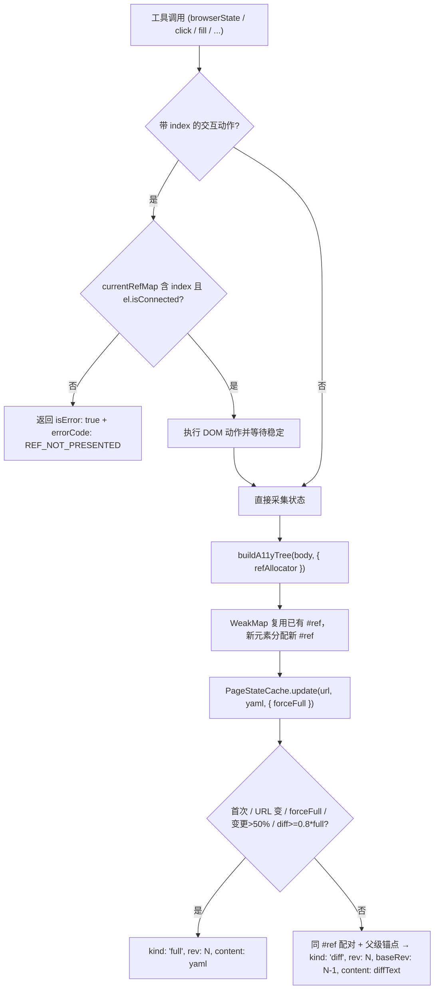

# Design：page-agent-tool 稳定元素编号与结构化增量 Diff 重构

## 方案概述

围绕「DOM 元素身份锚定」与「生成端保护性结构化 Diff」重构 `page-agent-tool` 的状态感知链路：

1. **元素身份层（`a11y/`）**：引入基于 `WeakMap<Element, number>` + 单调自增计数器的 `ElementRefAllocator`，替代每次重建归零的局部计数器；并在序列化后过滤 `refMap` 使其与 YAML 实际输出的 `#N` 集合严格一致。
2. **增量对比与版本层（`page-state-cache.ts`）**：维护会话级 `rev` 版本号；利用稳定 `#ref` 对 Myers 行级差异块执行同 `#ref` 就近配对，补充最小父级缩进锚点；当变更行数占比 `> 50%` 或 Diff 文本长度 `>= 整页 YAML 长度` 时自动熔断回退整页树（`kind: 'full'`）。
3. **协议与生命周期层（`page-agent-tool.ts` / `context.ts` / `handlers/`）**：在状态 JSON 中输出 `kind`、`url`、`rev`、`baseRev`；统一各交互 handler 的失效引用错误为 `isError: true` + `errorCode: 'REF_NOT_PRESENTED'`；在 `PAGE_AGENT_CHAT_END_EVENT` 及 `PageAgentToolHandle.resetSession()` 处执行会话级重置。

## 涉及模块 / 文件

| 路径 | 职责 |
| --- | --- |
| `packages/next-sdk/page-tools/a11y/ref-allocator.ts` | 新增 `ElementRefAllocator` 与 `RefAllocator` 接口 |
| `packages/next-sdk/page-tools/a11y/types.ts` | `A11yTreeOptions` 增加可选 `refAllocator?: RefAllocator` |
| `packages/next-sdk/page-tools/a11y/vnode.ts` | `buildVNode` 通过 `RefAllocator` 分配稳定 `#ref`；收集实际输出的 `#ref` |
| `packages/next-sdk/page-tools/a11y/build.ts` | 支持外部传入 `refAllocator`（默认新建临时实例保持纯函数兼容）；对齐 `refMap` 与输出 `lines` |
| `packages/next-sdk/page-tools/page-state-cache.ts` | 重构结构化 Diff（同 `#ref` 配对 + 父级锚点 + 阈值熔断回退 + `rev`/`baseRev`） |
| `packages/next-sdk/page-tools/context.ts` | 定义 `REF_NOT_PRESENTED_ERROR_CODE`、`staleRefError`、`resetSession` 及结构化状态类型 |
| `packages/next-sdk/page-tools/page-agent-tool.ts` | 串联会话级 `ElementRefAllocator`、`PageStateCache`、`kind/rev/baseRev` 组装与 `resetSession` 句柄 |
| `packages/next-sdk/page-tools/page-agent-tool-event.ts` | `PAGE_AGENT_CHAT_END_EVENT` 触发 `actionContext.resetSession()`；透传 `errorCode` |
| `packages/next-sdk/page-tools/handlers/{click,fill,select,hover,scroll,searchTree}.ts` | 统一校验 `el && el.isConnected` 并走 `staleRefError`；`searchTree` 共用 `refAllocator` 且不污染 Diff 基线 |
| `packages/next-sdk/page-tools/page-agent-prompt.md` | 更新 `#N` 稳定绑定、过期不复用、`kind/rev/baseRev` 与 Diff 格式说明 |
| `packages/next-sdk/index.ts` | 导出 `ElementRefAllocator`、`REF_NOT_PRESENTED_ERROR_CODE` 及相关类型 |
| `docs/webmcp-sdk/page-agent-tool.md` / `packages/next-sdk/skills/page-agent/SKILL.md` | 同步用户文档与编码 Skill |

## 核心数据结构 / 类型定义

```typescript
/** DOM 元素稳定编号分配器接口 */
export interface RefAllocator {
  /** 为元素返回稳定编号：已分配则复用，未分配则单调递增分配新编号 */
  allocate(el: Element): number
  /** 重置映射表与计数器（新一轮对话开始/上一轮对话结束时调用） */
  reset(): void
}

export type SnapshotKind = 'full' | 'diff'

export interface PageSnapshot {
  url: string
  yaml: string
  lines: string[]
  rev: number
}

export interface StateCacheUpdateOptions {
  /** 强制返回全量快照（如显式传入 responseMode: 'full'） */
  forceFull?: boolean
  /** 最大允许变更行数比例，超过则回退整页，默认 0.5 */
  maxChangeLineRatio?: number
  /** 最大允许 diffText / fullYaml 字符长度比，达到或超过则回退整页，默认 1.0 */
  maxDiffCharRatio?: number
}

export interface DiffResult {
  /** 本次实际产出的快照形态（diff 过大回退时自动变为 'full'） */
  kind: SnapshotKind
  /** 当前快照版本号（从 1 单调递增，reset 后归 0） */
  rev: number
  /** 当 kind === 'diff' 时，指明本 diff 所基于的基准快照版本号 */
  baseRev?: number
  /** 是否为全量刷新（等价于 kind === 'full'，保留字段兼容内部调用） */
  isFullRefresh: boolean
  /** 触发全量输出的原因（调试与测试断言用） */
  fullReason?: 'initial' | 'url_changed' | 'forced' | 'diff_too_large'
  /** 上一次快照的 URL */
  prevUrl: string
  /** 新增行数 */
  addedLines: number
  /** 删除行数 */
  removedLines: number
  /** 结构化 +/- 差异文本（无变化时为 '# (no changes)'） */
  diffText: string
}

export const REF_NOT_PRESENTED_ERROR_CODE = 'REF_NOT_PRESENTED' as const

export type PageAgentToolErrorResult = PageAgentToolContentResult & {
  isError: true
  error: string
  errorCode?: string
}

export type PageAgentToolHandle = {
  showMask: (options?: ShowMaskOptions) => Promise<void>
  hideMask: () => Promise<void>
  resetSession: () => void
}
```

## Diff 算法细节

1. **提取内容行**：剥离 `buildA11yTree` 外层 ```` ```yaml ```` 与 ```` ``` ```` 围栏，得到 `prevLines` 与 `currLines`。若两者逐行全等，直接返回 `kind: 'diff'`, `addedLines: 0`, `removedLines: 0`, `diffText: '# (no changes)'`（前提是不满足 `forceFull` / 首次 / URL 变更）。
2. **Myers 行对比 + Hunk 聚合**：使用 `diffArrays(prevLines, currLines, { comparator: (a, b) => a.trimStart() === b.trimStart() })` 执行忽略纯缩进平移的语义行级对比（防止外层容器穿透切换引起整棵子树缩进偏移 2 格误判），将相邻的 `removed` 与 `added` 片段聚合成变更 Hunk（记下其在 `prevLines` 和 `currLines` 中的起始行下标）。
3. **同 `#ref` 就近配对（Same-Ref Pairing）**：
   - 解析行内 `#ref`：匹配 `/^\s*-\s+\S+\s+#(\d+)(?:\s|\[|"|$)/`。
   - 对每个 Hunk 中的 `removed` 行与 `added` 行：
     - 若 `#N` 同时存在于两侧：代表同一元素发生属性/状态/文本/缩进更新，按其在 `currLines` 出现的顺序成对输出 `- oldLine` 紧跟 `+ newLine`；
     - 仅存在于 `removed` 侧的行：输出 `- oldLine`；
     - 仅存在于 `added` 侧的行：输出 `+ newLine`。
4. **最小父级缩进锚点（Minimal Ancestor Context）**：
   - 对 Hunk 中首条变更行（缩进 `indent > 0`）：在目标树（有新增/修改取 `currLines`，纯删除取 `prevLines`）向上回溯严格缩进更小的父级链路，选取最近的最多 2 层祖先节点（如 `  - dialog "确认框"` 或 `- main "主内容区"`）。
   - 用 `emittedCurrAncestors: Set<number>` / `emittedPrevAncestors: Set<number>` 去重，未输出过的祖先以 `'  ' + line`（2 空格上下文前缀，与 `'+ '`、`'- '` 对齐列宽）插入在该 Hunk 之前。顶层节点（`indent === 0`）不产生任何上下文行。
5. **双重熔断回退整页树**：
   - 计算 `totalLines = Math.max(prevLines.length, currLines.length)`，`changedRatio = totalLines > 0 ? Math.max(addedLines, removedLines) / totalLines : 0`。
   - 若 `changedRatio > maxChangeLineRatio (0.5)` 或 `diffText.length >= yaml.length * maxDiffCharRatio (1.0)`，判定 `fullReason = 'diff_too_large'`，回退为 `kind: 'full'`（不返回 `baseRev`，外层直接使用完整 `yaml`）。

## 依赖变更

无新增第三方依赖（复用已有 `diff` 包中的 `diffArrays`）。

## API / 行为变更

| 符号或行为 | 变更类型 | 说明 |
| --- | --- | --- |
| `ElementRefAllocator` / `RefAllocator` | 新增 | 稳定 DOM 元素 `#ref` 分配器，支持 `allocate(el)` 与 `reset()` |
| `A11yTreeOptions.refAllocator` | 新增（可选） | 允许外部传入持久化分配器；省略时单次调用仍从 `#0` 开始 |
| `PageAgentToolHandle.resetSession` | 新增 | 手动重置当前会话的 `stateCache`、`refAllocator`、`currentRefMap` 与高亮 |
| `PAGE_AGENT_CHAT_END_EVENT` 监听行为 | 修改 | 除 `hideMask()` 外同步执行 `resetSession()` |
| `browserState` JSON 字段 | 修改 | 新增 `kind: 'full' \| 'diff'`、`rev: number`，`kind === 'diff'` 时含 `baseRev: number` |
| 失效/不存在 `#ref` 处理 | 修改 | `click/fill/select/hover/scroll` 统一返回 `isError: true` + `errorCode: 'REF_NOT_PRESENTED'`，不再静默塞整页树 |
| `REF_NOT_PRESENTED_ERROR_CODE` | 新增 | 导出错误码常量 `'REF_NOT_PRESENTED'` |

## 数据流 / 时序



## 风险与兼容

- **`buildA11yTree` 向后兼容**：未传 `refAllocator` 时每次调用内部新建分配器，保证现有纯函数调用与全部历史单测零破坏。
- **`searchTree` 与版本链连续性**：`searchTree` 共用 `refAllocator` 并刷新 `currentRefMap`（搜到即可点），但**不**调用 `stateCache.update`，避免在未返回全量/增量快照的情况下推进 `rev` 造成宿主侧 `baseRev` 断链。
- **`webmcp-cli` 兼容**：`stateObj` 仍保持顶层平铺 JSON 且 `content` 为字符串，`webmcp-cli` 的 `formatLogResult` 原样兼容并能打印新增的 `kind` / `rev` / `baseRev` 元数据。

## 备选方案（未采用）

- **完全移除增量 Diff（Playwright MCP 路线）**：虽然实现最简单，但在高频微交互（勾选单选框、展开下拉、填写多项表单）下每次传输数万字符全量树，在未折叠窗口内 Token 开销仍然偏高；采用「稳定编号 + 阈值熔断回退整页」兼具增量省流与剧变兜底优势。
- **每次重排编号并在 Diff 前抹除 `#ref`**：虽能缩小 Diff 文本，但 AI 在上下文中持有的旧 `#ref` 与最新 DOM 发生静默错位，极易误点错误按钮，故必须从根源将 `#ref` 绑定到 DOM 元素。
