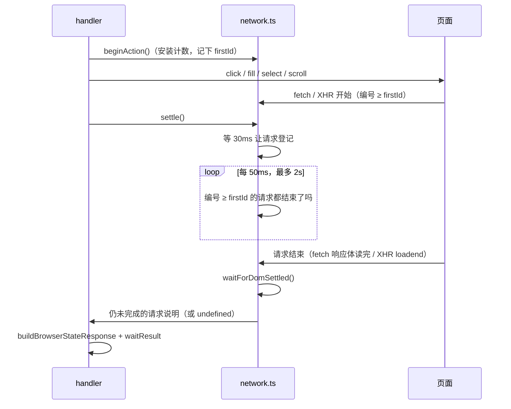

# Design：动作后等待动作期间发起的请求

## 方案概述

新增 `utils/network.ts`。第一次执行动作时包装页面的 `window.fetch` 与 `XMLHttpRequest.prototype.open` / `send`：每个请求分配单调递增编号，开始时连同方法、URL、开始时间放入进行中集合，结束时移除。动作执行前调用 `beginAction()` 记下当前编号；动作执行后调用 `settle()`，只等待编号不小于该值的请求。等待结束时仍有这类请求，`settle()` 返回说明文字，handler 通过 `withSettleNote` 把它写入结果的 `waitResult` 字段。



## 涉及模块 / 文件

| 路径                                              | 职责                                    |
| ------------------------------------------------- | --------------------------------------- |
| `packages/next-sdk/page-tools/utils/network.ts`   | 请求计数与 `beginAction()` / `settle()` |
| `packages/next-sdk/page-tools/handlers/click.ts`  | `waitForDomSettled()` 换成 `settle()`   |
| `packages/next-sdk/page-tools/handlers/fill.ts`   | 同上                                    |
| `packages/next-sdk/page-tools/handlers/select.ts` | 同上                                    |
| `packages/next-sdk/page-tools/handlers/scroll.ts` | 滚动动画结束后调用 `settle()`           |
| `docs/webmcp-sdk/page-agent-tool.md`              | 用户文档                                |
| `packages/next-sdk/skills/page-agent/SKILL.md`    | 编码 Agent Skill                        |

## 核心数据结构 / 类型定义

无新公开类型。模块内状态：`inflight: Map<number, { method, url, startedAt }>`、`seq: number`、`installed: boolean`。

```typescript
export function beginAction(maxWaitMs = 2000): { settle(): Promise<string | undefined> }
export function withSettleNote<T>(res: T, note: string | undefined): T
```

- `fetch`：包装函数分配编号并调用原函数。响应到达后读取 `response.clone()` 的响应体直到结束，再移除编号；`fetch` 的 Promise 在响应头到达时就落定，页面要等响应体收完才能渲染。`content-type` 为 `text/event-stream` 的响应不会结束，在响应头到达时移除编号。请求失败时立即移除。
- XHR：包装 `open` 记录方法与 URL；包装 `send` 分配编号，注册一次性 `loadend` 监听移除编号。
- `settle()`：先等 30ms（事件处理函数常在 `await` 之后才发请求），再每 50ms 检查一次，直到没有编号 ≥ `firstId` 的进行中请求或到达上限，然后调用 `waitForDomSettled()`。此时仍有编号 ≥ `firstId` 的请求时，返回形如 `[等待结果] 已等待 2.2s，仍有 1 个请求未完成：GET /api/export?id=7（已 2.2s）；页面有加载指示（progressbar）。返回的页面状态可能还未更新` 的说明：最多列 3 个请求，同源 URL 只显示路径和查询串，超过 80 个字符截断；加载指示取未隐藏的 `[aria-busy="true"]`、`[role="progressbar"]`。

用编号而不是时间戳区分动作前后的请求：同一毫秒内登记的请求也能区分开。

## 依赖变更

无。

## API / 行为变更

| 符号或行为                                                     | 变更类型 | 说明                                            |
| -------------------------------------------------------------- | -------- | ----------------------------------------------- |
| `click` / `fill` / `select` 返回前的等待                       | 修改     | 先等动作期间发起的请求，再等 DOM 稳定           |
| `scroll` 返回前的等待                                          | 修改     | 滚动动画结束后，等动作期间发起的请求与 DOM 稳定 |
| 工具结果 `waitResult` 字段                                     | 新增     | 等待结束时仍有本次动作发起的请求未完成时出现    |
| 页面 `window.fetch` / `XMLHttpRequest.prototype.open` / `send` | 修改     | 首次动作后被包装（只记录请求开始与结束）        |

## 风险与兼容

- **改写页面全局对象**：页面之后整体替换 `window.fetch` 时，计数失效，行为退回为只等待 DOM 稳定。检查 `fetch` 是否为原生实现的页面（如对比 `fetch.toString()`）会看到非原生函数。
- **2 秒上限**：接口超过 2 秒时，动作返回的仍是加载态，结果的 `waitResult` 说明仍有请求未完成，Agent 需要再取一次状态。模型调用一次通常就要数秒，再取状态时多数接口已经返回；上限越长，每次遇到慢请求或长轮询的动作都越慢。
- **读取响应副本**：`clone()` 让浏览器同时向页面和副本提供响应体。页面不读取响应体时，副本仍会把响应体下载完。
- **页面在包装之前缓存了 `fetch` 引用**（例如模块初始化时 `const f = window.fetch`）：通过该引用发出的请求不计数。XHR 包装的是原型，不受影响。
- **耗时增加**：没有请求时多 30ms；`scroll` 原来不等待 DOM 稳定，现在每次多出约 30ms + 150ms。
- **埋点、预取请求**：动作触发的埋点或预取请求也会被等待，最长到上限。

## 备选方案（未采用）

- **提供 `wait` 动作，由模型决定等多久**：不改写页面全局对象，但每次加载都要模型多调用一步，且模型需要判断当前是否为加载态。
- **固定延长 `waitForDomSettled` 的时间**：所有动作都变慢，接口时长不固定时仍不可靠。
- **用 `PerformanceObserver` / Resource Timing 判断进行中的请求**：Resource Timing 条目在响应体结束后才生成，进行中的请求没有条目（在 Chromium 上实测 fetch、XHR、流式响应、SSE 均如此），无法用于等待。
- **扩展的 `chrome.webRequest`**：能看到进行中的请求且不改写页面全局对象，但需要宿主扩展声明 `webRequest` 权限；本包作为页面内 SDK 运行时没有扩展，仍需要页面内实现。
