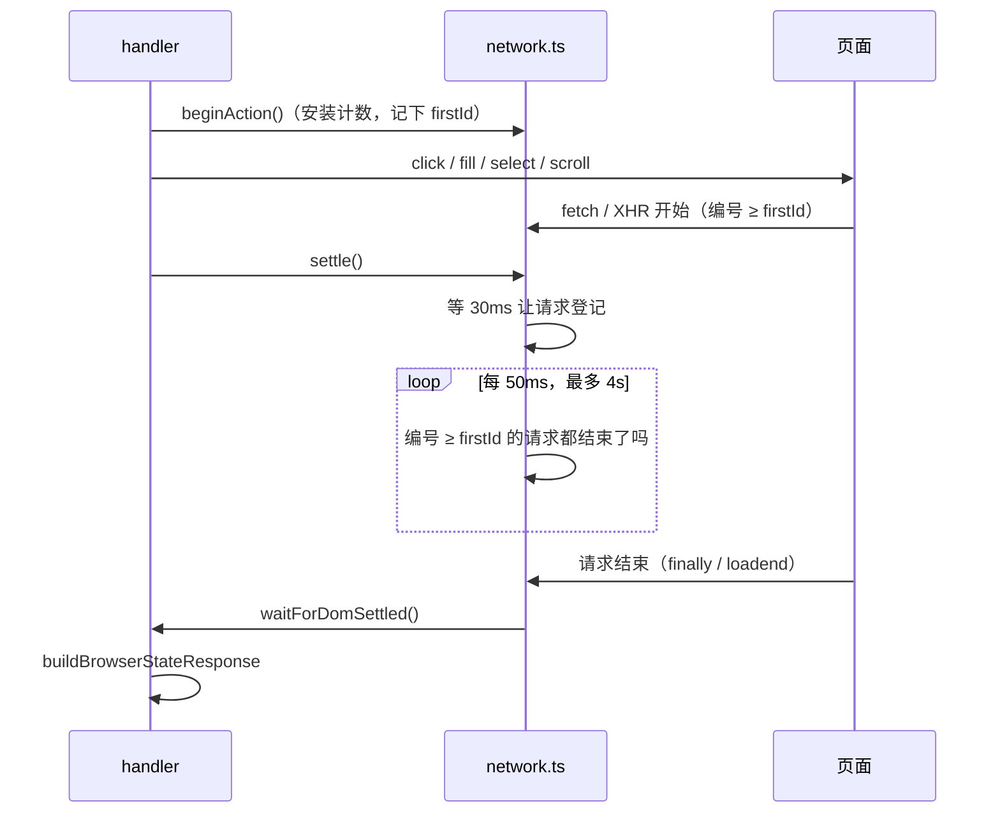

# Design：动作后等待动作期间发起的请求

## 方案概述

新增 `utils/network.ts`。第一次执行动作时包装页面的 `window.fetch` 与 `XMLHttpRequest.prototype.send`：每个请求分配单调递增编号，开始时放入进行中集合，结束时移除。动作执行前调用 `beginAction()` 记下当前编号；动作执行后调用 `settle()`，只等待编号不小于该值的请求。



## 涉及模块 / 文件

| 路径                                              | 职责                                    |
| ------------------------------------------------- | --------------------------------------- |
| `packages/next-sdk/page-tools/utils/network.ts`   | 请求计数与 `beginAction()` / `settle()` |
| `packages/next-sdk/page-tools/handlers/click.ts`  | `waitForDomSettled()` 换成 `settle()`   |
| `packages/next-sdk/page-tools/handlers/fill.ts`   | 同上                                    |
| `packages/next-sdk/page-tools/handlers/select.ts` | 同上                                    |
| `packages/next-sdk/page-tools/handlers/scroll.ts` | 滚动动画结束后调用 `settle()`           |
| `docs/webmcp-sdk/page-agent-tool.md`              | 用户文档                                |
| `packages/next-sdk/skills/page-agent/SKILL.md`    | 编码 Agent Skill                        |

## 核心数据结构 / 类型定义

无新公开类型。模块内状态：`inflight: Set<number>`、`seq: number`、`installed: boolean`。

```typescript
export function beginAction(maxWaitMs = 4000): { settle(): Promise<void> }
```

- `fetch`：包装函数分配编号，调用原函数，在返回 Promise 的 `finally` 中移除编号。
- XHR：包装 `send`，分配编号，注册一次性 `loadend` 监听移除编号。
- `settle()`：先等 30ms（事件处理函数常在 `await` 之后才发请求），再每 50ms 检查一次，直到没有编号 ≥ `firstId` 的进行中请求或到达上限，最后调用 `waitForDomSettled()`。

用编号而不是时间戳区分动作前后的请求：同一毫秒内登记的请求也能区分开。

## 依赖变更

无。

## API / 行为变更

| 符号或行为                                            | 变更类型 | 说明                                            |
| ----------------------------------------------------- | -------- | ----------------------------------------------- |
| `click` / `fill` / `select` 返回前的等待              | 修改     | 先等动作期间发起的请求，再等 DOM 稳定           |
| `scroll` 返回前的等待                                 | 修改     | 滚动动画结束后，等动作期间发起的请求与 DOM 稳定 |
| 页面 `window.fetch` / `XMLHttpRequest.prototype.send` | 修改     | 首次动作后被包装（只计数）                      |

## 风险与兼容

- **改写页面全局对象**：页面之后整体替换 `window.fetch` 时，计数失效，行为退回为只等待 DOM 稳定。检查 `fetch` 是否为原生实现的页面（如对比 `fetch.toString()`）会看到非原生函数。
- **4 秒上限**：接口超过 4 秒时，动作返回的仍是加载态，Agent 需要再取一次状态。
- **耗时增加**：没有请求时多 30ms；`scroll` 原来不等待 DOM 稳定，现在每次多出约 30ms + 150ms。
- **埋点、预取请求**：动作触发的埋点或预取请求也会被等待，最长到上限。

## 备选方案（未采用）

- **提供 `wait` 动作，由模型决定等多久**：不改写页面全局对象，但每次加载都要模型多调用一步，且模型需要判断当前是否为加载态。
- **固定延长 `waitForDomSettled` 的时间**：所有动作都变慢，接口时长不固定时仍不可靠。
