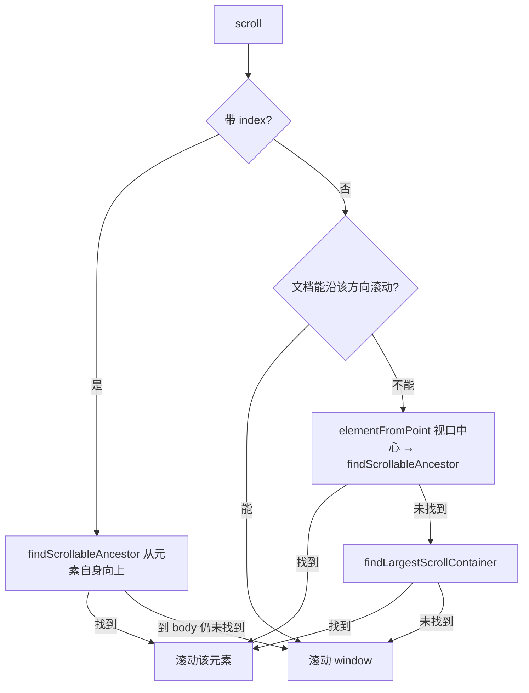

# Design：scroll 滚动内部容器

## 方案概述

`handleScroll` 在滚动前先确定滚动目标，再沿用原有的位移计算与边界判断。目标选择只依赖 DOM 与计算样式，不依赖调试协议。



## 涉及模块 / 文件

| 路径                                              | 职责                                                                              |
| ------------------------------------------------- | --------------------------------------------------------------------------------- |
| `packages/next-sdk/page-tools/utils/scroll.ts`    | `findScrollableAncestor`、`findLargestScrollContainer`、`describeScrollContainer` |
| `packages/next-sdk/page-tools/handlers/scroll.ts` | 选择滚动目标；结果文案注明容器；`numPages` 按目标高度换算                         |
| `packages/next-sdk/page-tools/schema.ts`          | `scroll` 描述                                                                     |
| `docs/webmcp-sdk/page-agent-tool.md`              | 用户文档                                                                          |
| `packages/next-sdk/skills/page-agent/SKILL.md`    | 编码 Agent Skill                                                                  |

## 核心数据结构 / 类型定义

无新公开类型。「可滚动」的判定：

```typescript
function canScroll(el: Element, vertical: boolean): boolean {
  const style = (el.ownerDocument.defaultView ?? window).getComputedStyle(el)
  if (!/(auto|scroll|overlay)/.test(vertical ? style.overflowY : style.overflowX)) return false
  return vertical ? el.scrollHeight > el.clientHeight + 1 : el.scrollWidth > el.clientWidth + 1
}
```

- `findScrollableAncestor(el, vertical)`：从 `el` 自身开始沿 `parentElement` 向上，遇到 shadow root 时跳到 `host`；到达 `body` / `html` 时返回 `null`，由调用方滚动 `window`。
- `findLargestScrollContainer(vertical)`：遍历 `body` 下的元素，先用 `scrollHeight` / `clientHeight` 粗筛，再取计算样式，返回与视口交集面积最大的可滚动元素。

## 依赖变更

无。

## API / 行为变更

| 符号或行为                             | 变更类型 | 说明                                                                   |
| -------------------------------------- | -------- | ---------------------------------------------------------------------- |
| `scroll`（带 `index`）                 | 修改     | 滚动元素自身或最近的可滚动祖先                                         |
| `scroll`（不带 `index`，文档不能滚动） | 修改     | 滚动视口中央所在容器，回落到可见面积最大的容器                         |
| `scroll` 结果文案                      | 修改     | 追加「（滚动的是所在容器 …）」或「（页面本身不能滚动，已滚动容器 …）」 |
| `numPages` 换算                        | 修改     | 乘以实际滚动目标的可视高度                                             |

## 风险与兼容

- `findLargestScrollContainer` 遍历全部元素，只在文档不能滚动、视口中心也不在可滚动容器内时执行；粗筛条件过滤掉大多数元素后才取计算样式。
- 页面上有多个可滚动面板时，不带 `index` 只会滚动其中一个；结果文案注明了容器，Agent 可以改传其他面板内元素的编号。
- 「文档能否滚动」按 `window` 的 `scrollY` 与文档高度判断；文档还能滚时行为与现状一致。

## 备选方案（未采用）

- **在页面内派发合成 `wheel` 事件，由浏览器选择滚动目标**：脚本派发的事件 `isTrusted` 为 `false`，按 UI Events 规范，不受信任的事件除 `click` 外不触发默认动作，`wheel` 不会产生滚动。
- **通过调试协议发送真实滚轮事件**：浏览器会按光标位置选择容器，但需要挂调试器，`page-tools` 运行在页面内不具备该能力。
