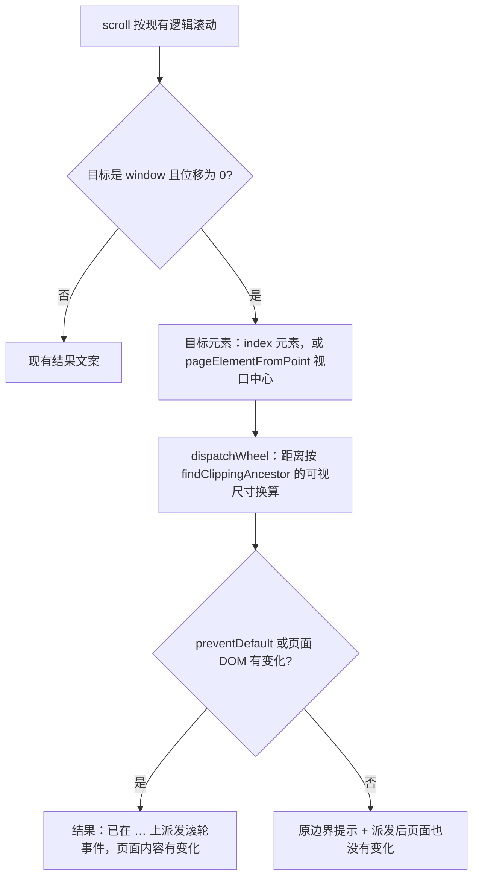

# Design：scroll 在自行处理滚轮的区域派发滚轮事件

## 方案概述

`handleScroll` 按现有逻辑选择滚动目标并滚动。滚动目标是 `window` 且没有位移时，再派发一次合成 `WheelEvent`，根据页面是否响应决定结果文案。

## 涉及模块 / 文件

| 路径                                              | 职责                                                                             |
| ------------------------------------------------- | -------------------------------------------------------------------------------- |
| `packages/next-sdk/page-tools/utils/scroll.ts`    | `findClippingAncestor`、`dispatchWheel`；`inSdkOverlay` 供命中测试与变化检测共用 |
| `packages/next-sdk/page-tools/handlers/scroll.ts` | 位移为 0 时派发滚轮事件并生成结果文案                                            |
| `packages/next-sdk/page-tools/schema.ts`          | `scroll` 描述                                                                    |
| `docs/webmcp-sdk/page-agent-tool.md`              | 用户文档                                                                         |
| `packages/next-sdk/skills/page-agent/SKILL.md`    | 编码 Agent Skill                                                                 |

## 核心逻辑

- `findClippingAncestor(el, vertical)`：从 `el` 自身向上找该轴计算样式 `overflow` 为 `hidden` / `clip` 的元素，穿过 shadow root，到 `body` 为止。自绘滚动区通常用它裁剪内容，它的可视高度就是「一屏」。
- `dispatchWheel(target, delta)`：先用 `MutationObserver` 监听 `body` 子树，再派发 `bubbles`、`cancelable`、`composed` 的 `WheelEvent`（`deltaMode` 为像素，`clientX` / `clientY` 取目标中心），之后调用 `waitForDomSettled()` 等页面渲染。返回 `defaultPrevented` 或是否有不在 SDK 遮罩与高亮层内的变化记录。

## 依赖变更

无。

## API / 行为变更

| 符号或行为                           | 变更类型 | 说明                                                       |
| ------------------------------------ | -------- | ---------------------------------------------------------- |
| `scroll`（文档和容器都不能原生滚动） | 修改     | 额外派发一次合成滚轮事件                                   |
| `scroll` 结果文案                    | 修改     | 页面响应时说明派发位置与距离；不响应时在边界提示后追加说明 |

## 风险与兼容

- 合成事件 `isTrusted` 为 `false`，不会触发浏览器的原生滚动，只有页面脚本自己监听 `wheel` 的区域会响应，不会意外滚动其他容器。
- 页面上与滚轮无关的定时更新（轮播、时钟）可能在等待期间改动 DOM，结果会报「页面内容有变化」。等待时间受 `waitForDomSettled` 的上限约束（600ms）。
- 页面没有任何滚动区域时，多出一次派发和最多 600ms 等待。
