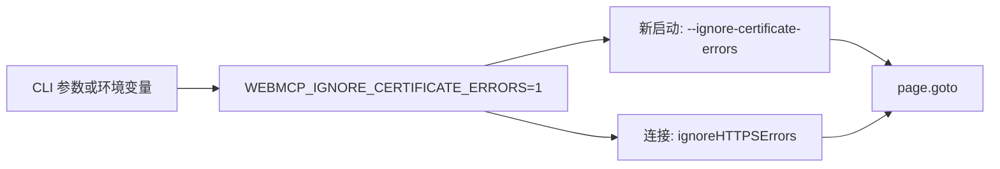

# Spec：允许关闭网站证书验证 - design.md

## 方案概述

在 CLI 入口把 `--ignore-certificate-errors` 写成 `WEBMCP_IGNORE_CERTIFICATE_ERRORS=1`。浏览器启动与连接只读这个环境变量：新进程追加 Chrome 参数，已有进程通过 Puppeteer `ignoreHTTPSErrors` 下发 `Security.setIgnoreCertificateErrors`。默认不设置该变量，校验行为不变。

## 涉及模块 / 文件

- `packages/webmcp-cli/src/browser.ts`：判断开关、组装启动参数与连接选项
- `packages/webmcp-cli/src/bin.ts`：全局 option、写入环境变量、stderr 警告
- `packages/webmcp-cli/README.md`
- `packages/webmcp-cli-skill/cdp/SKILL.md`
- `packages/webmcp-cli/test/ignore-certificate-errors.test.ts`

## 核心数据结构 / 类型定义

```typescript
export function shouldIgnoreCertificateErrors(): boolean

export interface ChromeLaunchArgsInput {
  cdpPort: number
  userDataDir: string
  headless: boolean
  /** 缺省时读取 WEBMCP_IGNORE_CERTIFICATE_ERRORS */
  ignoreCertificateErrors?: boolean
}

export function buildChromeLaunchArgs(input: ChromeLaunchArgsInput): string[]

export function buildPuppeteerConnectOptions(browserBaseUrl: string): {
  browserURL: string
  defaultViewport: null
  ignoreHTTPSErrors?: boolean
}
```

`shouldIgnoreCertificateErrors()` 仅当 `process.env.WEBMCP_IGNORE_CERTIFICATE_ERRORS === '1'` 时返回 `true`。

`buildChromeLaunchArgs` 在需要忽略时追加 `--ignore-certificate-errors`，其余参数与现有启动参数一致（调试端口、user-data-dir、`--no-first-run`、`--no-default-browser-check`，以及 headless 时的沙箱相关参数）。

`buildPuppeteerConnectOptions` 仅在开关打开时带上 `ignoreHTTPSErrors: true`，关闭时不传该字段。

## 依赖变更

- 无新依赖。使用已有 `puppeteer-core` 22 的 `ignoreHTTPSErrors` 与 `commander` 11。

## API / 行为变更

| 符号或行为 | 变更类型 | 说明 |
|---|---|---|
| `--ignore-certificate-errors` | 新增 | 全局 CLI 参数，无短选项。置 `WEBMCP_IGNORE_CERTIFICATE_ERRORS=1` |
| `WEBMCP_IGNORE_CERTIFICATE_ERRORS` | 新增 | 仅 `1` 表示打开。与 CLI 参数等价 |
| Chrome 启动参数 | 修改 | 开关打开时追加 `--ignore-certificate-errors` |
| `puppeteer.connect` | 修改 | 开关打开时 `ignoreHTTPSErrors: true` |
| 默认证书校验 | 不变 | 未打开开关时与现在一致 |

这些函数只从 `browser.ts` 导出供单测使用，不加入包入口 `src/index.ts`。

## 数据流 / 时序



`bin.ts` 的 `preAction` 在发现该 option 时写入环境变量。若环境变量已是 `1`（参数或外部导出），向 stderr 打印：`当前受控浏览器已关闭 TLS 证书校验。`

`connectBrowser` 不解析 argv。`tabs open`、`run` 触发的导航、MCP `browser_tabs_open` 都经过 `connectBrowser`，因此都会带上同一设置。

## 风险与兼容

- 打开后，该 Chrome 进程内之后的导航都会跳过证书校验，包括随后不带此参数的命令。Puppeteer 只在为 `true` 时下发忽略，不会在后续连接里改回 `false`。
- 不写入 profile。进程退出后恢复默认校验，除非再次传入参数或环境变量。
- 该能力会让受控浏览器接受无效证书，存在中间人风险。默认关闭，且打开时必须警告。
- WXT 模式不读取该开关。

## 备选方案

- 只在 `tabs open` 上加参数：已驻留的浏览器和新启动路径对不齐，MCP 与页面内跳转也覆盖不到。
- 只加 Chrome 启动参数、不设置 `ignoreHTTPSErrors`：浏览器已经在跑时，后一次命令无法改启动参数。
