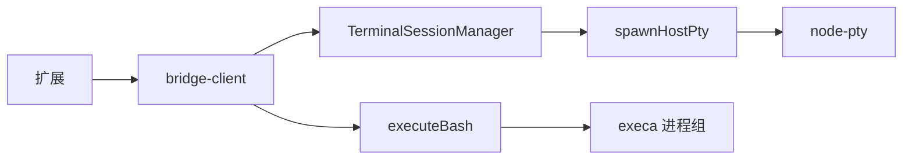

# Spec：宿主机命令与交互终端 - design.md

## 方案概述

一次性命令继续用 execa。非 Windows 且 `tty: true` 时，由 Python `pty.fork` 提供终端 stdout，并把子进程 stdin 换成 `/dev/null`，使只读 stdin 的命令立刻遇到 EOF。

交互终端继续用 node-pty，但改成打开会话时再 `require`。包清单把它放进 `optionalDependencies`。安装脚本把各平台 `spawn-helper` 设为 `0755`；运行时 chmod 遇到 `EPERM`/`EACCES` 时，把原因写进启动失败输出。

超时由调用方自己计时。POSIX 上子进程 `detached`，超时后对进程组发 `SIGTERM`，两秒后再 `SIGKILL` 并销毁仍被占用的输出管道。Windows 用 `taskkill /T /F`。

终端关闭时先用 `ps` 找到 shell 的子孙进程并 `SIGKILL`（前台作业会另起进程组，且可能忽略 `SIGHUP`），再对 shell 发 `SIGHUP`。Windows 使用 `taskkill /T /F`。扩展 socket 的 `bufferedAmount` 超过 1MiB 时暂停 PTY 读取，降到一半以下后恢复。新扩展连接在替换 socket 之前 `disposeAll()`。

## 涉及模块 / 文件

- `packages/webmcp-cli/src/bridge/bash-executor.ts`
- `packages/webmcp-cli/src/bridge/pty-backend.ts`
- `packages/webmcp-cli/src/bridge/terminal-session.ts`
- `packages/webmcp-cli/src/bridge/bridge-client.ts`
- `packages/webmcp-cli/scripts/ensure-pty-helper.mjs`
- `packages/webmcp-cli/package.json`
- `packages/webmcp-cli/test/bash-executor.test.ts`
- `packages/webmcp-cli/test/pty-backend.test.ts`
- `packages/webmcp-cli/test/terminal-session.test.ts`
- `packages/webmcp-cli/test/bridge-client.test.ts`

## 核心数据结构 / 类型定义

```typescript
export interface HostPty {
  write(data: string): void
  resize(cols: number, rows: number): void
  kill(): void
  pause(): void
  resume(): void
  onData(cb: (data: string) => void): void
  onExit(cb: (info: { exitCode: number | null; signal: string | null }) => void): void
}

export const TERMINAL_OUTPUT_HIGH_WATER = 1024 * 1024

export function applyTerminalBackpressure(
  bufferedAmount: number,
  flow: { pauseOutput(): void; resumeOutput(): void }
): void
```

JSON-RPC 请求 id 只接受字符串、有限数字或 `null`。其他值响应 `{ id: null, error: { code: -32602 } }`，不回显原 id。

## 依赖变更

- `node-pty` 从 `dependencies` 挪到 `optionalDependencies`，版本仍为 `^1.1.0`。
- 新增 `postinstall`：`node scripts/ensure-pty-helper.mjs`。该脚本随包发布。

## API / 行为变更

| 符号或行为 | 变更类型 | 说明 |
|---|---|---|
| `executeBash({ tty: true })` | 修改 | stdin 立即 EOF，stdout 仍是终端 |
| `onOutput` / `maxBuffer` | 修改 | 超限后仍推送，最终结果截断 |
| `executeBash` 超时 | 修改 | 结束进程组，不等后代占用的管道 |
| `terminal/open` 加载失败 | 修改 | 缺少 node-pty 时抛错，不先创建会话 |
| 扩展连接替换 | 修改 | 先销毁终端，再替换 socket |
| 终端输出 | 修改 | 按 socket 积压暂停 / 恢复 PTY |
| 请求 id | 修改 | 非标量 id 直接拒绝 |

## 数据流 / 时序



## 风险与兼容

- POSIX 超时路径使用 `detached`。execa 在该模式下不会在父进程退出时自动清理，超时与正常结束仍由本模块结束进程组或等待命令自己退出。
- 关闭终端时按进程树 `SIGKILL`，不依赖 macOS `pkill` 没有的按会话结束能力。已经脱离该进程树的守护进程不在范围内。
- 协议方法名与 `PROTOCOL_VERSION` 不变。非法 id 的响应 id 从「原样回显」改为 `null`。

## 备选方案

- 继续把 node-pty 作为必需依赖，并在文档中要求 Linux 安装编译工具。安装失败会挡住不使用终端的用户，因此不采用。
